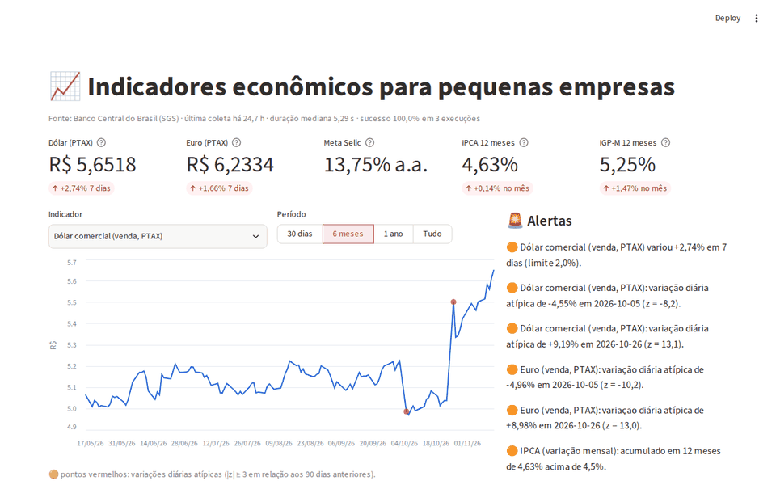
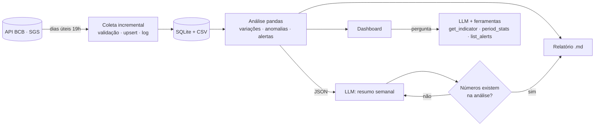

# 📈 Intelligent Data Dashboard: indicadores econômicos para pequenas empresas

**Coleta automática de câmbio, juros e inflação direto do Banco Central, alertas quando algo sai do normal, um dashboard para acompanhar e uma camada de IA que resume a semana e responde perguntas em português, sempre com números conferidos contra os dados.**



> GIF gravado com o dashboard rodando e a **IA ao vivo** (`gemini-3.5-flash-lite`): o resumo da semana é o texto real gerado por `idash relatorio --ia`, e a pergunta é respondida na hora (a maior alta diária do dólar em 30 dias: +9,19% em 26/10, conferida contra o banco). O resumo traz o aviso de "dados de câmbio desatualizados há 3 dias", que é um dos defeitos documentados em [Validação com o Gemini real](#validação-com-o-gemini-real): 14 e 15/11 foram fim de semana, sem cotação.


## O problema

Quem tem uma pequena empresa que compra insumos importados ou reajusta preços pela inflação precisa acompanhar dólar, Selic e IPCA. Na prática, isso vira abrir o site do Banco Central de vez em quando, copiar números para uma planilha e **perceber tarde** que o câmbio disparou na semana.

**Usuário-alvo:** dono(a) ou gestor(a) de pequena empresa, sem analista de dados.

## A solução

| Etapa | O que faz | Onde |
|---|---|---|
| **Coleta** | Busca incremental na API pública do BCB (SGS), com retentativas, validação (formato, datas futuras, duplicatas), *upsert* que captura revisões e log de cada execução | [`collector.py`](src/idash/collector.py) |
| **Agendamento** | GitHub Actions em dias úteis às 19h; versiona dados e relatório no repositório | [`coleta.yml`](.github/workflows/coleta.yml) |
| **Análise** | Variações de 1, 7, 30 dias e 12 meses, acumulados de inflação, mínimo e máximo, **anomalias por z-score** e regras de alerta configuráveis | [`analysis.py`](src/idash/analysis.py) |
| **IA** | Resumo semanal com **checagem de números** e perguntas em linguagem natural via *function calling* em ferramentas fixas (sem SQL livre) | [`insights.py`](src/idash/insights.py) |
| **Entrega** | Dashboard Streamlit e relatório Markdown | [`app/`](app/streamlit_app.py), [`reports/`](reports/) |



### Decisões de projeto

- **Sem SQL gerado pelo modelo.** As perguntas em linguagem natural usam três ferramentas com parâmetros validados. É menos flexível que *text-to-SQL*, mas toda resposta é auditável (o dashboard mostra quais ferramentas foram consultadas) e não há como o modelo rodar uma consulta arbitrária.
- **A análise é a fonte única de números.** O resumo recebe só o JSON da análise. `ungrounded_numbers` confere cada percentual e valor em R$ do texto; se algum não existir, o modelo recebe a lista e reescreve. A comparação é exata em duas casas: um teste garante que "99,99%" não passa como "100,00%".
- **A IA é opcional.** Sem `GEMINI_API_KEY`, coleta, alertas, relatório e dashboard funcionam normalmente. O resumo é um complemento, não um ponto único de falha.
- **Datas futuras são descartadas.** A série da meta Selic é publicada com datas à frente (a meta vale até o próximo Copom), e exibi-las como "dado de hoje" seria errado.

## Resultados medidos (sem LLM)

Execuções reais em 15/11/2026, nesta máquina:

| Métrica | Resultado |
|---|---|
| Carga inicial (5 séries desde 01/2023) | 3.449 observações em ~15 s |
| Coleta incremental seguinte | 0 linhas novas, ~5 s (5 requisições) |
| Alertas gerados na data | 7: dólar +2,74% em 7 dias, 4 variações diárias atípicas no câmbio, mudança da meta Selic (14,00% → 13,75%), IPCA 12 meses em 4,63% (acima de 4,5%) |
| Testes offline | 13 (API simulada, falhas parciais, revisões de dados, anomalias, checagem de números, perguntas com ferramentas, dias úteis, notificações) |

O detector de anomalias marcou duas variações diárias muito grandes no câmbio (−4,55% em 05/10 e +9,19% em 26/10/2026), com z-score acima de 8. Os valores são os retornados pela API. O dashboard destaca esses pontos para que alguém confira se é movimento real ou correção na fonte, que é exatamente o tipo de coisa que passaria despercebida numa planilha.

## Status da validação

| Componente | Status |
|---|---|
| Coleta, validação, análise, alertas, relatório, dashboard | ✅ executados com dados reais |
| Resumo semanal por IA | ✅ rodado com o **Gemini real** (`gemini-3.6-flash`, 16/11/2026): todos os números do texto conferem com a tabela; veja a ressalva abaixo |
| Perguntas em linguagem natural | ✅ rodado com o **Gemini real**: 3 de 4 respostas exatas, 1 com janela de datas diferente da minha; veja abaixo |
| Agendamento no GitHub Actions | ✅ rodando: 4 de 4 dias úteis entre 18 e 21/11/2026, 100% de sucesso, 4 a 6 s por execução (tabela `coletas`); veja abaixo |
| Perguntas com gabarito recalculado do SQLite | ✅ 23 de 23 respostas das ferramentas conferem; roda no CI a cada push |
| Resumo por IA na coleta agendada | ⏳ falta cadastrar o secret `GEMINI_API_KEY` no repositório: sem ele, o robô gera o relatório sem o resumo |

## Validação com o Gemini real

Rodado em 16/11/2026 com `gemini-3.6-flash`, contra os dados reais já coletados. A "verdade" de cada pergunta foi calculada direto no SQLite, sem passar pelo modelo.

| Pergunta | Resposta do Gemini | Verdade no banco | Resultado |
|---|---|---|---|
| Maior alta diária do dólar nos últimos 30 dias | +9,19% em 26/10, fechando em R$ 5,5007 | +9,19% em 26/10, R$ 5,5007 | ✅ exata |
| Qual é a meta Selic atual? | 13,75% a.a. (15/11); última mudança em 17/09, de 14,00% para 13,75% | idem | ✅ exata |
| Quanto o dólar variou no último mês e qual foi o pico? | +11,2% (16/10 a 13/11); pico de R$ 5,6518 em 13/11 | +12,05% (14/10 a 13/11); pico de R$ 5,6518 em 13/11 | ⚠️ pico exato; a variação usa outra janela |
| Qual será o preço do dólar na semana que vem? | Recusou prever e informou o último dado (13/11, R$ 5,6518) | não há previsão nos dados | ✅ recusa correta |

**Resumo semanal:** os 12 números citados (cotações, variações de 7 e 30 dias, Selic, IPCA e IGP-M acumulados e os dois desvios atípicos) existem na tabela do relatório, e a checagem de números do projeto não marcou nenhum.

**O que o teste revelou:**

- *"Último mês" é ambíguo.* O modelo contou 30 dias a partir da data de referência do relatório (16/11), e não do último dado (13/11), então a janela começou em 16/10 em vez de 14/10. A variação de 11,2% bate com os números que a ferramenta devolveu; a diferença está só na janela. Melhoria planejada: a ferramenta passar a ancorar a janela na última observação disponível.
- *Fim de semana tratado como atraso.* O resumo diz que o câmbio está "desatualizado há 3 dias", mas 14 e 15/11 foram sábado e domingo e o BCB não divulga PTAX. Melhoria planejada: contar atraso em dias úteis.

Amostra pequena (4 perguntas, 1 resumo, um único modelo): serve para mostrar que o fluxo funciona de ponta a ponta com o Gemini real, não como medida de acurácia.

## O agendamento em produção

Medido na tabela `coletas`, que registra cada execução:

| Métrica | Valor |
|---|---|
| Execuções agendadas | 4 de 4 dias úteis (18, 19, 20 e 21/11/2026) |
| Taxa de sucesso | 100% |
| Duração | 4 a 6 s (mediana de 4,3 s) |
| Intervalo entre coletas | mediana de 23,8 h |
| Horário real | entre 02h52 e 03h21 UTC, embora o cron peça 22h UTC |

O agendador do GitHub atrasou as execuções em cerca de 5 horas. Para este uso não faz diferença, porque a PTAX do dia já está publicada, mas um relatório que precisasse sair num horário certo exigiria outro agendador.

## Versão 2: mais perguntas, atraso em dias úteis e alertas no Telegram

- **23 perguntas com gabarito recalculado do SQLite** (`python eval/run_eval.py`). Elas cobrem último valor, variação, máxima e data da mínima em períodos fechados, inflação acumulada no ano e em 12 meses, e Selic média. O banco muda a cada coleta, então o gabarito não é fixo: o script recalcula a resposta certa com SQL e pandas, sem passar pelas funções do pacote, e compara com o que a ferramenta do agente devolve. Hoje as 23 conferem. Com `--gemini`, o script também faz as perguntas ao modelo e confere se o número certo aparece na resposta, mas isso ainda não foi rodado.
- **Atraso em dias úteis.** O alerta de dado desatualizado conta dias úteis (mais de 2 dias úteis sem dado novo), e não mais dias corridos. Fim de semana deixa de parecer atraso, que era o defeito visto no resumo do Gemini.
- **Janela ancorada no último dado.** A pergunta enviada ao modelo agora traz a data do último dado de cada indicador, e o prompt manda contar "último mês" a partir dela. Isso ataca a divergência de janela vista na validação. O efeito com o Gemini real ainda não foi medido.
- **Alertas no Telegram.** `idash notificar` envia os alertas novos de severidade alta, sem repetir os já enviados, e o workflow de coleta chama o comando depois de cada execução. Só funciona com os secrets `TELEGRAM_BOT_TOKEN` e `TELEGRAM_CHAT_ID`; sem eles, nada é enviado. Foi testado com o envio simulado, não com um bot real.

## Como rodar

```bash
python -m venv .venv && source .venv/bin/activate
pip install -e ".[ui,dev]"
idash coletar                     # baixa as séries do BCB (sem chave)
idash relatorio                   # análise + reports/ultimo.md
streamlit run app/streamlit_app.py
pytest -q
```

Com IA (opcional):

```bash
cp .env.example .env              # GEMINI_API_KEY=...
idash relatorio --ia
idash perguntar "Quanto o dólar variou no último mês e qual foi o pico?"
```

Regras de alerta: `DEFAULT_RULES` em [`analysis.py`](src/idash/analysis.py) (limite de variação do câmbio, teto de inflação etc.).

## Limitações

- Cinco séries fixas. Adicionar outras é uma linha em `SERIES`, mas as regras de alerta precisam ser pensadas por indicador.
- O z-score usa a janela dos 90 dias anteriores; após um choque grande, a sensibilidade cai por algumas semanas.
- Os alertas só vão para o Telegram se os secrets estiverem configurados. O envio real ainda não foi testado com um bot.
- Feriados nacionais contam como dia útil no cálculo de atraso, então um feriado isolado pode gerar um aviso de 1 dia útil sem dado.

## Roadmap

- [x] Ampliar o conjunto de perguntas com respostas conhecidas (23, com gabarito recalculado do SQLite)
- [x] Ancorar janelas de tempo na última observação e contar atraso em dias úteis
- [x] Envio de alertas pelo Telegram acionado pelo próprio workflow
- [ ] Rodar as 23 perguntas com o Gemini real e comparar modelos
- [ ] Exportação para Google Sheets e Looker Studio

---

Dados: Banco Central do Brasil, Sistema Gerenciador de Séries Temporais. Projeto pessoal, sem vínculo com o BCB. Licença MIT.
